# API Projeto Final – Produtos, Autenticação e Controle de Acesso

API REST em **Node.js + Express 5** que integra os conceitos do semestre: **CRUD**, **validação**, **tratamento global de erros padronizado**, **paginação, filtros e ordenação**, **autenticação JWT**, **senhas com hash (bcrypt)**, **RBAC por perfil** e **documentação Swagger/OpenAPI**.

| | |
| --- | --- |
| 🌐 **API em produção** | https://SEU-APP.onrender.com |
| 📖 **Swagger (produção)** | https://SEU-APP.onrender.com/api-docs |
| 🧪 **Coleção de testes** | [`docs/postman/`](docs/postman) (Postman/Insomnia) · [`api.http`](api.http) (já aponta para a nuvem) |
| 🖼️ **Evidências (prints)** | [`docs/evidencias/`](docs/evidencias) · [galeria abaixo](#evidências-de-funcionamento) |
| 🎤 **Roteiro da apresentação** | [`docs/APRESENTACAO.md`](docs/APRESENTACAO.md) |

> ⏱️ **Plano gratuito da nuvem:** a API "dorme" após ~15 min sem uso e a **primeira requisição pode levar de 30 a 60 s**. Abra `/health` alguns minutos antes de testar ou apresentar.

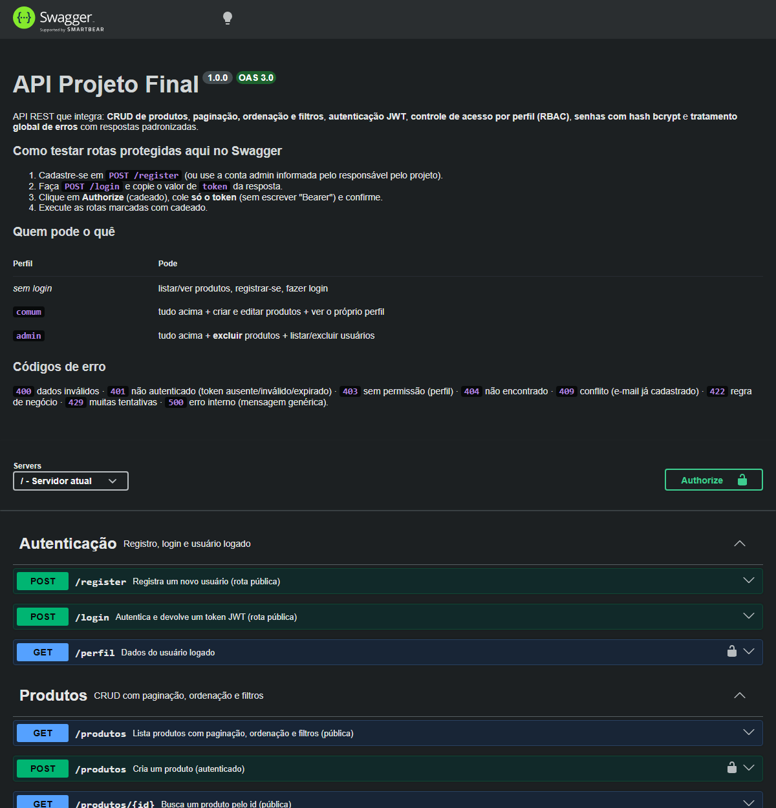

## Stack

Node.js 20+ · Express 5 · **Zod** (validação) · **bcryptjs** (hash de senha) · **jsonwebtoken** (JWT) · **swagger-ui-express** (OpenAPI 3) · **Helmet** + **express-rate-limit** (segurança) · testes com `node:test` e **Newman** (coleção Postman).

## Como rodar localmente

```bash
npm install
npm start          # cria o .env sozinho (valores aleatórios) e sobe a API
```

- API: http://localhost:3000 · Swagger: http://localhost:3000/api-docs
- Na **primeira execução** o `npm start` cria o arquivo `.env` com um `JWT_SECRET` aleatório e uma **senha de admin aleatória**, e mostra o e-mail e a senha do admin **uma vez** no terminal (ficam salvos no `.env`, que **não vai para o Git**).

```bash
npm test                  # 45 testes automatizados
npm run test:collection   # roda a coleção do Postman (27 requisições, 103 asserções) no terminal
```

### Variáveis de ambiente

Todas vêm do ambiente (`.env` local ou painel da nuvem). O modelo está em [`.env.example`](.env.example), só com valores de exemplo.

| Variável | Descrição | Padrão |
| --- | --- | --- |
| `JWT_SECRET` | **Segredo que assina os tokens** (mín. 32 caracteres, aleatório). A API **não sobe** sem ele. | gerado pelo `npm start` |
| `ADMIN_EMAIL` / `ADMIN_PASSWORD` | Conta admin criada ao iniciar (única forma de existir um admin) | gerados no `.env` local |
| `JWT_EXPIRES_IN` | Validade do token | `1h` |
| `BCRYPT_ROUNDS` | Custo do bcrypt | `10` |
| `RATE_LIMIT_AUTH_MAX` | Tentativas de `/login` e `/register` por janela de 15 min, por IP | `40` |
| `TRUST_PROXY` | `1` quando está atrás de proxy (nuvem) | `0` |
| `PORT` | Porta | `3000` |

## Rotas

| Método | Rota | Acesso | Descrição | Respostas |
| --- | --- | --- | --- | --- |
| POST | `/register` | pública | Cadastra usuário (sempre perfil `comum`) | 201, 400, 409, 429 |
| POST | `/login` | pública | Valida credenciais e devolve o JWT | 200, 400, 401, 429 |
| GET | `/perfil` | autenticado | Dados do usuário logado | 200, 401 |
| GET | `/produtos` | pública | Lista com **paginação, filtros e ordenação** | 200, 400 |
| GET | `/produtos/:id` | pública | Detalhe do produto | 200, 400, 404 |
| POST | `/produtos` | autenticado | Cria produto | 201, 400, 401 |
| PUT | `/produtos/:id` | autenticado | Substitui por completo | 200, 400, 401, 404 |
| PATCH | `/produtos/:id` | autenticado | Atualiza parcialmente | 200, 400, 401, 404 |
| DELETE | `/produtos/:id` | **admin** | Exclui produto | 204, 400, 401, **403**, 404 |
| GET | `/usuarios` | **admin** | Lista usuários | 200, 401, **403** |
| DELETE | `/usuarios/:id` | **admin** | Exclui usuário | 204, 400, 401, **403**, 404, 422 |
| GET | `/health` | pública | Verifica se a API está no ar | 200 |
| GET | `/api-docs` | pública | Swagger UI | 200 |

### Listagem: parâmetros de `GET /produtos`

| Parâmetro | Exemplo | Descrição |
| --- | --- | --- |
| `page`, `limit` | `page=2&limit=20` | Paginação. Padrão `1` e `10`. **`limit` acima de 100 é reduzido para 100.** |
| `sort`, `order` | `sort=preco&order=desc` | Ordenação. `sort`: `id` (padrão), `nome`, `categoria`, `preco`, `estoque`, `criadoEm`. |
| `categoria` | `categoria=eletronicos` | `eletronicos`, `livros`, `moda`, `casa`, `esportes` (ignora acento/maiúscula). |
| `ativo` | `ativo=true` | Produtos ativos ou inativos. |
| `search` | `search=notebook` | Parte do nome. |
| `minPrice`, `maxPrice` | `minPrice=100&maxPrice=500` | Intervalo de preço (inclusivo). |

Resposta: `data` (itens) + `meta` (`totalItems`, `itemsPerPage`, `currentPage`, `totalPages` e links **HATEOAS** `first/prev/next/last` que **preservam os filtros**).

### Formato padrão de erro (todas as respostas de erro)

```json
{
  "status": 400,
  "error": "VALIDATION_ERROR",
  "message": "Os dados fornecidos são inválidos.",
  "details": [{ "field": "preco", "message": "O preço deve ser maior que 0." }],
  "timestamp": "2026-11-23T10:00:00.000Z"
}
```

| HTTP | `error` | Quando |
| --- | --- | --- |
| 400 | `VALIDATION_ERROR` / `INVALID_JSON` | Dados, parâmetros ou JSON inválidos |
| 401 | `UNAUTHORIZED` / `INVALID_TOKEN` / `TOKEN_EXPIRED` / `INVALID_CREDENTIALS` | Sem token, token ruim/expirado, login errado |
| 403 | `FORBIDDEN` | Autenticado, mas o perfil não permite |
| 404 | `ROUTE_NOT_FOUND` / `PRODUCT_NOT_FOUND` / `USER_NOT_FOUND` | Não existe |
| 409 | `USER_ALREADY_EXISTS` | E-mail já cadastrado |
| 422 | `CANNOT_DELETE_SELF` | Admin tentando excluir a própria conta |
| 429 | `TOO_MANY_REQUESTS` | Excedeu o limite de tentativas de login/cadastro |
| 500 | `INTERNAL_SERVER_ERROR` | Erro inesperado: **mensagem genérica**; o detalhe só vai para o log do servidor |

## Evidências de funcionamento

Capturas feitas **contra a API em execução** (senhas mascaradas e tokens truncados). Todas as imagens estão em [`docs/evidencias/`](docs/evidencias).

### ✔ Fluxos de sucesso

| Cadastro (201) | Login com token (200) | Rota protegida (200) |
| --- | --- | --- |
| 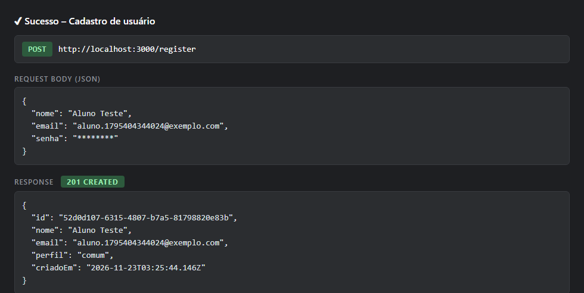 | 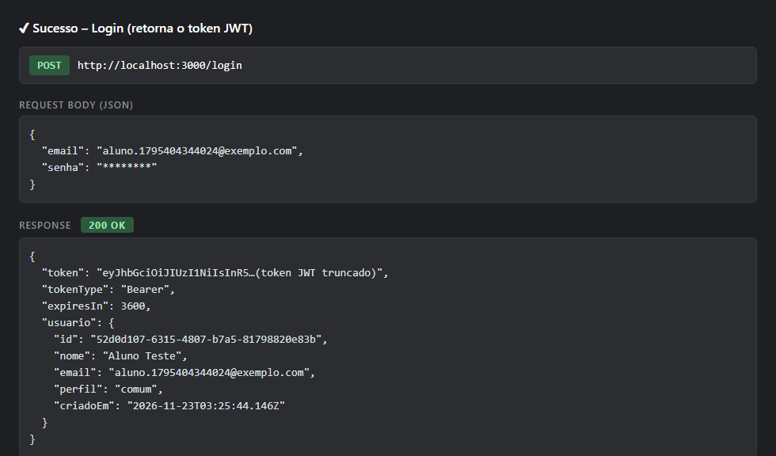 | 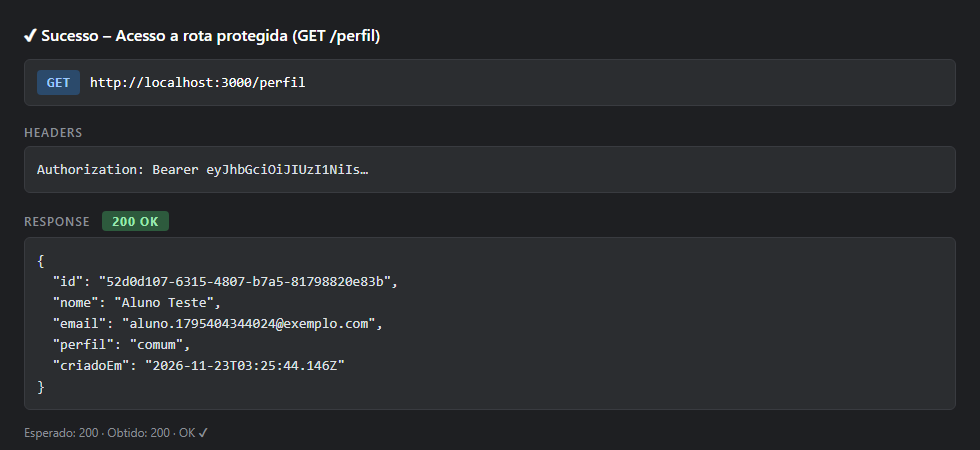 |

| Criar produto (201) | Paginação + filtros + ordenação (200) | PATCH (200) |
| --- | --- | --- |
| 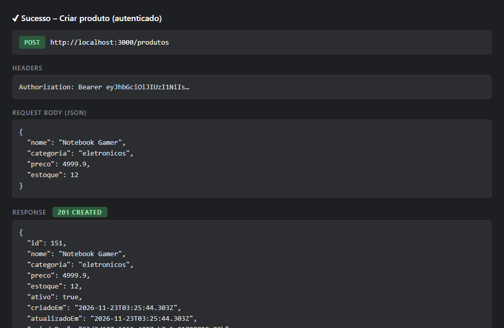 | 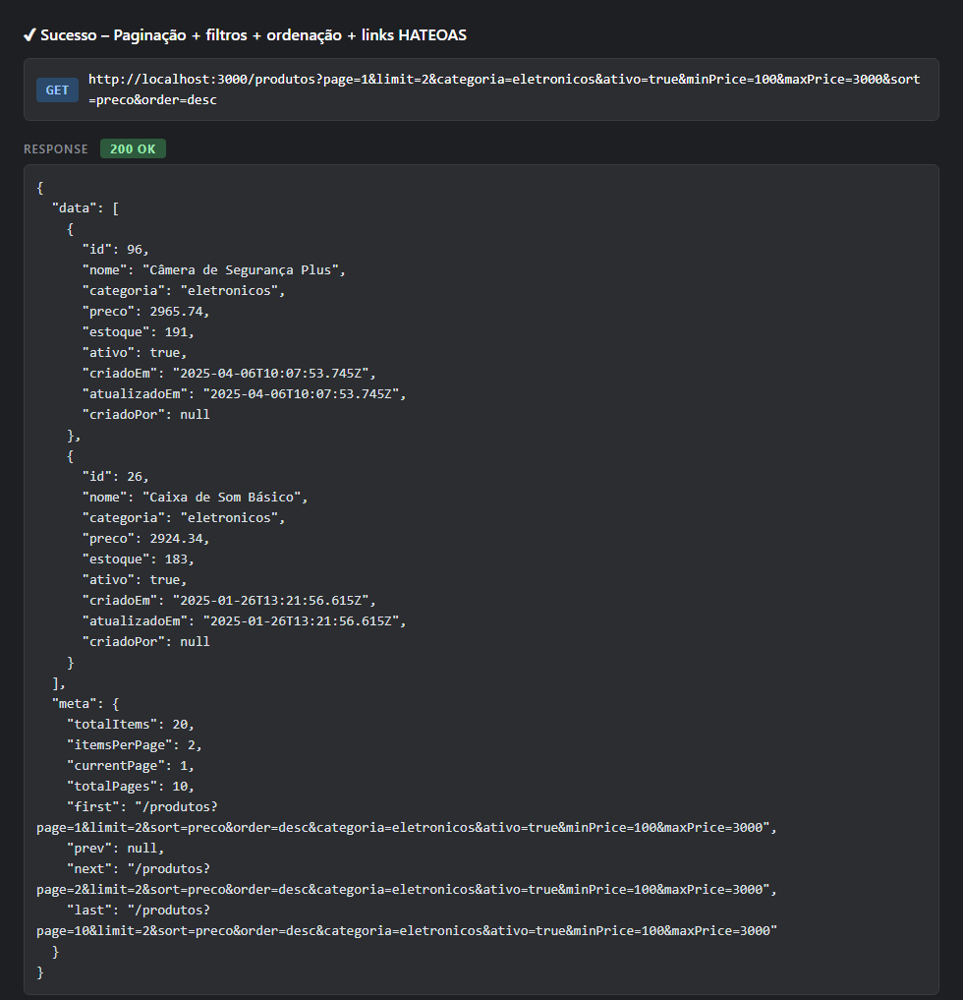 | 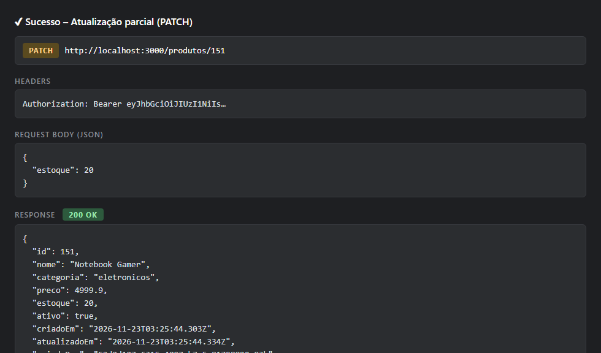 |

### ✖ Erros esperados (tratamento global funcionando)

| Sem token (401) | Perfil errado (403) | Dados inválidos (400) |
| --- | --- | --- |
| 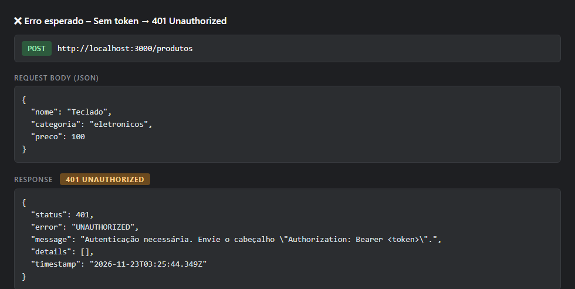 | 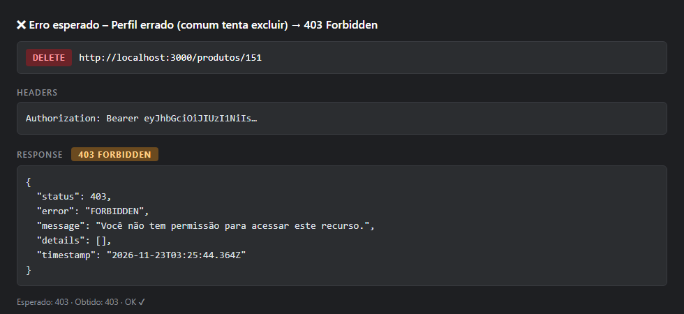 | 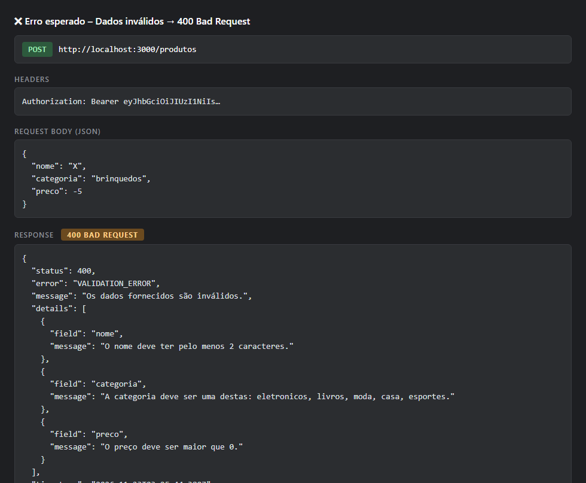 |

| Não encontrado (404) | E-mail duplicado (409) | JSON malformado (400) |
| --- | --- | --- |
| 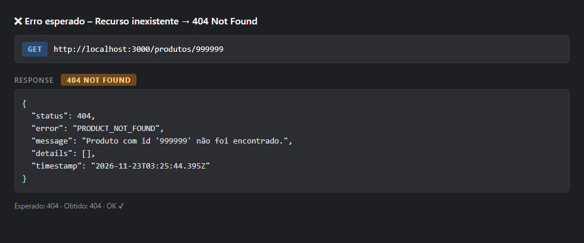 | 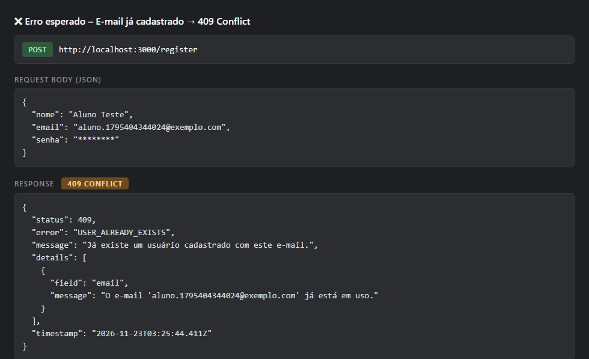 | 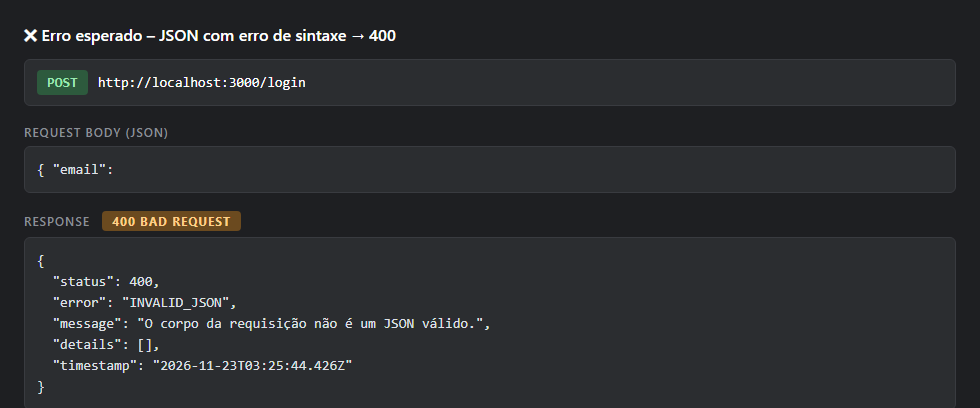 |

| Token inválido (401) | Admin exclui (204) |
| --- | --- |
| 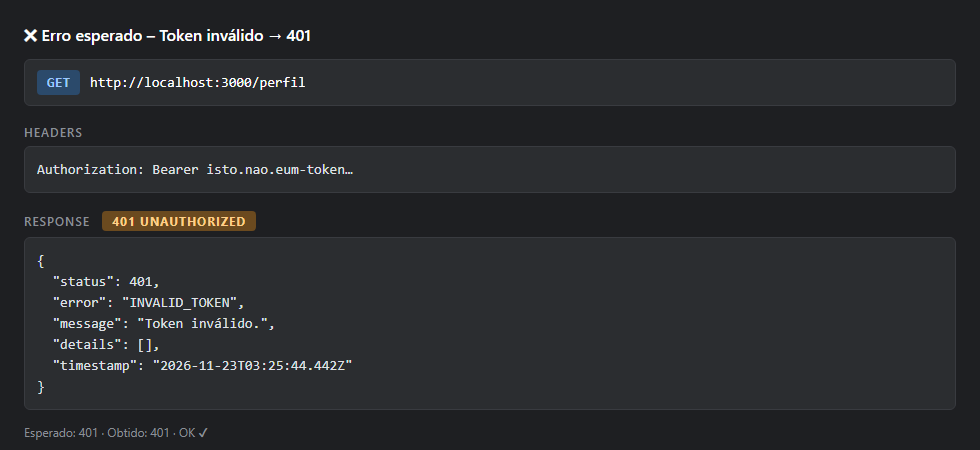 | 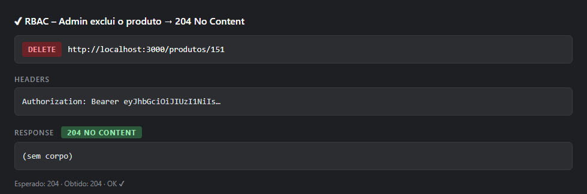 |

### 🧪 Testes automatizados e coleção Postman

| `npm test` (45 testes) | Coleção no Newman (27 req., 103 asserções) |
| --- | --- |
| 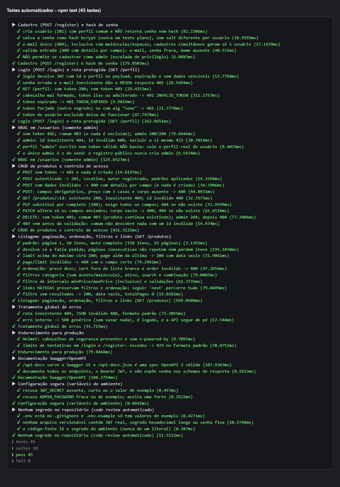 | 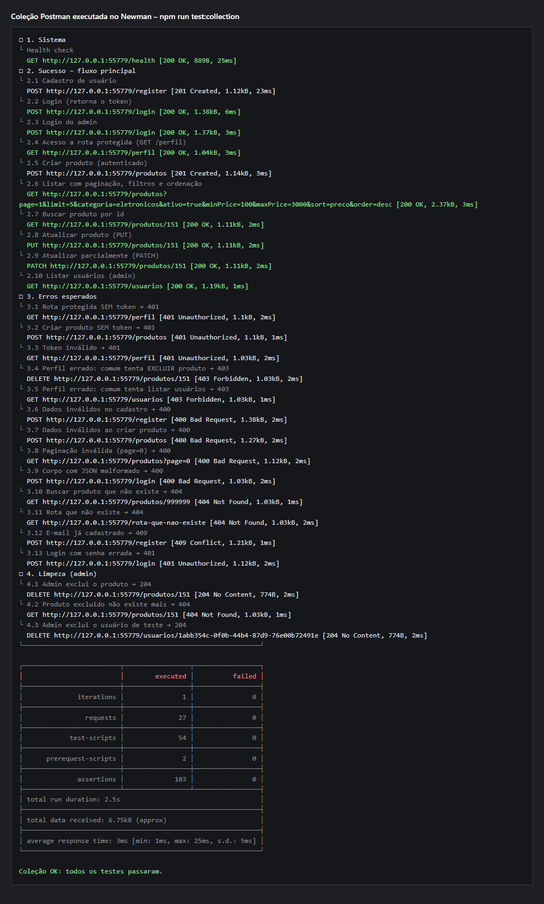 |

## Coleção de testes (Postman / Insomnia)

Em [`docs/postman/`](docs/postman):

- `api-projeto-final.postman_collection.json`: **27 requisições** em 4 pastas, cada uma com scripts de teste (`pm.test`):
  1. **Sistema:** health check;
  2. **Sucesso:** cadastro, login (guarda o token), rota protegida, CRUD de produtos, listagem com paginação/filtros, rota de admin;
  3. **Erros esperados:** **401** (sem token / token inválido), **403** (perfil errado), **400** (dados inválidos, JSON malformado, paginação inválida), **404** (produto e rota inexistentes), **409**, e login com senha errada;
  4. **Limpeza (admin):** exclusões (204) e conferência (404).
  Toda resposta de erro também é validada contra o formato padrão.
- `local.postman_environment.json` e `producao.postman_environment.json`: ambientes com `baseUrl`. Preencha `adminEmail` e `adminSenha` no ambiente (a senha do admin **não** fica no repositório).

**Como usar:** *Import* da coleção e de um ambiente → selecionar o ambiente → botão direito na coleção → *Run collection*. No Insomnia: *Import* do mesmo arquivo.
**Pelo terminal:** `npm run test:collection` (API temporária local) ou `npm run test:collection -- https://SEU-APP.onrender.com` (contra a nuvem; defina `ADMIN_EMAIL` e `ADMIN_PASSWORD` do admin da nuvem no ambiente).

## Revisão de código (code review): funcionalidades integradas

| Funcionalidade | Onde está | Provado por |
| --- | --- | --- |
| **CRUD** de produtos (POST, GET, PUT, PATCH, DELETE) | `src/routes/produtos.routes.js`, `src/services/produto.service.js` | `test/produtos.test.js`; coleção, pasta 2 |
| **Tratamento global de exceções** (formato único) | `src/middlewares/errorHandler.js`, `src/errors/AppError.js` | `test/seguranca.test.js`; checagem de formato em **toda** requisição da coleção |
| **Validação de entrada** (Zod): corpo, rota e query | `src/schemas/`, `src/middlewares/validate.js` | 400 com `details` por campo |
| **Paginação, filtros, ordenação, intervalo, HATEOAS** | `src/repositories/produto.repository.js`, `src/utils/paginacao.js` | `test/produtos.test.js` (navegação por todas as páginas) |
| **Autenticação JWT** (login, middleware, expiração) | `src/services/token.service.js`, `src/middlewares/authenticate.js` | `test/auth.test.js` (forjado, `alg: none`, expirado, adulterado) |
| **Senha com hash bcrypt** | `src/services/auth.service.js` | hash no formato bcrypt, salt diferente por usuário, nunca retornada |
| **RBAC** (401 × 403) | `src/middlewares/authorize.js` | comum recebe 403; admin recebe 204 |
| **Swagger/OpenAPI** com Bearer JWT | `src/openapi.js` → `/api-docs` | spec validada (`swagger-parser`) |

### Segredos e configuração

- ✅ `JWT_SECRET` e a senha do admin vêm **só de variáveis de ambiente**. O `.env` está no `.gitignore`; no Git há apenas o `.env.example` com valores de exemplo (`troque-...`).
- ✅ **Nenhuma senha fixa no repositório** (nem a do admin): no `npm start` ela é gerada aleatoriamente; na nuvem é informada no painel.
- ✅ A API **recusa iniciar** com `JWT_SECRET` ausente/curto/de exemplo ou com `ADMIN_PASSWORD` fraca.
- ✅ **Varredura automática** (teste "Nenhum segredo no repositório"): procura JWT completo, segredo hexadecimal longo, senha fixa e confere o `.gitignore`.
- ✅ Hash de senha e hash de verificação nunca saem pela API (`usuarioPublico()` é uma lista de campos *permitidos*).
- ✅ Dependências de produção: `npm audit --omit=dev` → **0 vulnerabilidades**. (O `newman` é só ferramenta de teste, `devDependency`, e não vai para o deploy.)
- ✅ Banco de dados: o projeto usa repositórios em memória, então **não há credenciais de banco**. Se um banco for adicionado, a `DATABASE_URL` seguiria o mesmo padrão (variável de ambiente).

## Arquitetura

```
src/
├── app.js                 # Express: Helmet, Swagger, rate limit, rotas, 404, handler de erros
├── server.js              # carrega o .env, cria o admin, sobe o servidor, encerra com SIGTERM
├── config/env.js          # valida as variáveis de ambiente
├── openapi.js             # especificação OpenAPI
├── routes/                # auth, produtos, usuarios
├── middlewares/           # authenticate (401), authorize (403), validate (400), errorHandler
├── services/              # regras de negócio (auth, token, produto, usuario, seedAdmin)
├── repositories/          # acesso a dados (em memória; troque por um banco só aqui)
├── schemas/               # regras de validação (Zod)
├── errors/AppError.js     # exceções customizadas
├── utils/                 # logger, paginação/HATEOAS, usuarioPublico
└── data/produtos.seed.js  # 150 produtos de exemplo
test/                      # 45 testes (autenticação, CRUD, listagem, segurança, Swagger, segredos)
docs/                      # evidências (prints), coleção Postman, roteiro da apresentação
scripts/                   # setup do .env, runner da coleção, definir-url
render.yaml                # deploy no Render (blueprint)
```

## Deploy na nuvem (Render)

O repositório já tem o [`render.yaml`](render.yaml). O `JWT_SECRET` é gerado pelo próprio Render e **nenhum segredo vai para o Git**.

1. Suba o código para o GitHub.
2. Em render.com: **New → Blueprint** → conecte o GitHub e escolha este repositório.
3. Quando o Render pedir, informe `ADMIN_EMAIL` e `ADMIN_PASSWORD` (8+ caracteres, com letra e número). Esses valores ficam só no painel.
4. Clique em **Apply**. Ao terminar, a URL pública aparece no topo do serviço (ex.: `https://api-projeto-final.onrender.com`).
5. Teste `https://SUA-URL/health` e abra `https://SUA-URL/api-docs`.
6. Troque o endereço de exemplo pela URL real em toda a documentação, com um comando:
   ```bash
   node scripts/definir-url.js https://SUA-URL.onrender.com
   ```
7. Valide a API publicada com a coleção:
   ```bash
   npm run test:collection -- https://SUA-URL.onrender.com
   ```
   (com `ADMIN_EMAIL` e `ADMIN_PASSWORD` do passo 3 no ambiente ou no `.env`).

Outras plataformas funcionam igual: comando de build `npm ci --omit=dev`, de start `node src/server.js`, e as mesmas variáveis de ambiente. Em produção use **HTTPS** (o Render já fornece).

## Limitações conhecidas e próximos passos

- **Dados em memória:** reiniciam com o servidor (e o plano gratuito reinicia ao "acordar"). Próximo passo: PostgreSQL (só a camada `repositories/` muda).
- **JWT sem revogação antes de expirar:** mitigado com validade curta (1 h) e checagem de que o usuário ainda existe. Evolução: refresh token.
- **CORS** não está configurado (não há frontend neste projeto). Um frontend em outro domínio precisaria de `cors`.
- **CI/CD:** hoje os testes rodam localmente; o próximo passo seria rodá-los automaticamente a cada push (GitHub Actions).

## Reflexão (Parte 4)

### Qual a diferença entre "funciona na minha máquina" e "está pronto para produção"?

Na **minha máquina** o ambiente é perfeito e previsível: um único usuário (eu), rede local sem latência, dados que eu mesmo criei, segredos num arquivo que só eu vejo, e ninguém tentando me atacar. Se algo quebra, eu estou ali para reiniciar.

Em **produção** tudo isso muda:

- **Rede e infraestrutura:** há latência, quedas, proxies e balanceadores no meio, HTTPS obrigatório, portas e variáveis definidas pela plataforma, e o servidor pode "dormir" e reiniciar (a primeira requisição demora, e os dados em memória somem).
- **Segurança:** o mundo inteiro pode chamar a API, inclusive quem quer abusar dela. Daí vêm senhas com hash, segredo do JWT fora do código, controle de acesso por perfil, limite de tentativas, cabeçalhos de segurança e erros que não vazam detalhes internos.
- **Concorrência:** vários usuários ao mesmo tempo, cadastros simultâneos com o mesmo e-mail, requisições fora de ordem. Esse tipo de bug não aparece quando só eu testo (por isso há um teste de cadastros simultâneos).
- **Entradas imprevisíveis:** JSON quebrado, campos faltando, `limit=9999999`, tokens forjados. Em produção, "o usuário nunca faria isso" não existe.
- **Operação:** ninguém está olhando o terminal. É preciso health check, logs internos, encerramento gracioso (SIGTERM) e uma forma de saber se está tudo funcionando.

"Pronto para produção" significa que o sistema **continua correto e seguro quando as condições deixam de ser ideais**, e que eu consigo **provar** isso.

### Por que a tríade Documentação (Swagger) + Testes (Coleções/QA) + Deploy (Nuvem) separa um projeto de estudante de um profissional?

- **Documentação (Swagger/OpenAPI):** é o **contrato** da API. Qualquer pessoa (frontend, QA, professor) entende endpoints, parâmetros, schemas e erros sem perguntar, e testa as rotas protegidas direto no navegador com o Bearer token. Documentação desatualizada é pior que nenhuma; por isso aqui a spec é código, versionada junto, e validada por um teste.
- **Testes (45 automatizados + coleção com 103 asserções):** **provam** que o sistema é resiliente e previsível. Cobrem não só o caminho feliz, mas os erros (401, 403, 400, 404, 409), os ataques (token forjado, `alg: none`, escalada para admin) e até se há segredo vazando no repositório. Quem testa pode mexer no código sem medo de quebrar o que já funcionava.
- **Deploy (nuvem):** é a única forma de saber se o sistema funciona fora da minha máquina. Ele força a lidar com variáveis de ambiente, segredos, HTTPS, health check, reinício e dados efêmeros, ou seja, com a realidade. Uma API que só roda em `localhost` ainda é um experimento, não um produto.

Juntas, as três respondem às perguntas que o mercado faz: *dá para usar?* (documentação), *dá para confiar?* (testes) e *está no ar?* (deploy). Um projeto de estudante normalmente resolve só o "funciona"; um profissional entrega o **funciona, está provado e está acessível**.
